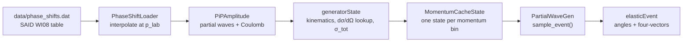
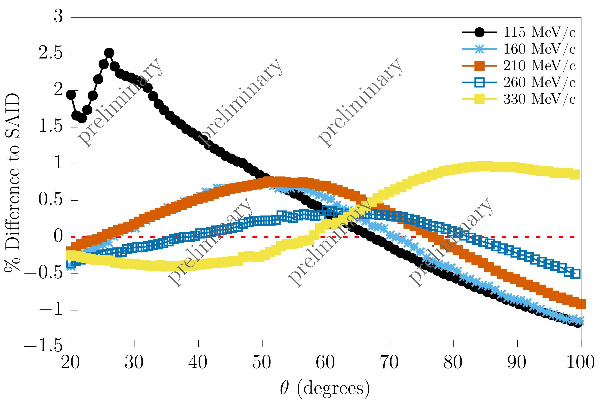
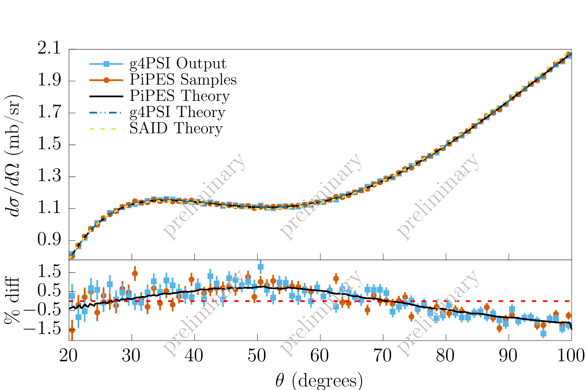

# Pion Proton Elastic Scattering Event Generator (PiPES)

## TL;DR
A header-only C++20 event generator for low-energy $\pi^{\pm} p$ elastic scattering. You give it a pion charge, a beam momentum and an angular range, and it gives back sampled scattering angles and the outgoing pion and proton four-vectors.

- Partial waves up to and including the $f$-wave ($\ell \leq 3$)
- Variable beam momentum within $\left[100, 340\right]\ \text{MeV}/c$ (phase shifts are interpolated)
- Coulomb contributions are included
- Scattering can be rotated about an incident beam direction that does not point along $z$
- Results can be output in the CM or lab frame

The generator is fairly simple to add as a hadronic interaction inside Geant4. Against experimental data it has given good results compared to FTFP_BERT.

Over 20 iterations of 1000000 sampled events each, the generator took $902\pm209$ ms per iteration. That is an average throughput of about $1.11$ million events/s.

## Overview
PiPES is pure C++ and header-only, with no external packages needed. The phase shift values and the functional forms for the differential cross section closely follow the George Washington Group's SAID database. In particular, it uses the WI08 solution phase shift parameters and theory curves for the comparisons below.

## Workflow


## Requirements
- A C++20 compiler
- CMake ≥ 3.10

## How to Use
PiPES is a CMake `INTERFACE` library. Add it to your own project with:

```cmake
add_subdirectory(path/to/PiPES PiPES)
target_link_libraries(<your_target> PRIVATE PiPES)
```

This sets up the include path and `PHASE_SHIFT_DATADIR`, which points to `data/` so the phase shift table is found automatically.

A minimal example:

```cpp
#include "PartialWaveGen.h"

int main()
{
    constexpr int L_MAX = 1;            // 0 = s, 1 = +p, 2 = +d, 3 = +f
    constexpr double theta_min = 10.;   // lab angle limits in degrees
    constexpr double theta_max = 179.;
    const double p_lab = 160.;          // MeV/c

    PartialWaveGen generator(charge::plus, L_MAX);
    MomentumCacheState cache(charge::plus, theta_min, theta_max);

    generator.set_lab_frame();                  // or set_cm_frame() (default)
    generator.set_beam_direction({0., 0., 1.}); // optional, default is +z
    generator.randomize_seed();                 // or set_seed(...)
    generator.set_state(cache.get_state(p_lab, L_MAX));

    for(int i = 0; i < 1000000; i++)
    {
        elasticEvent event = generator.sample_event();
        // event.thetaLab, event.phiLab, event.pionLab, event.protonLab, ...
    }
    double sigma = generator.get_total_cs(); // fm^2, within the chosen angular range
}
```

If the beam has a momentum spread, call `generator.set_state(cache.get_state(p, L_MAX))` before each event. The cache stores one state per 1 MeV/c bin, so the amplitude and lookup table are built only once for each bin.

## Output
Each call to `sample_event()` returns an `elasticEvent`:

| Field | Description |
|---|---|
| `thetaCM`, `phiCM` | Pion scattering angles in the CM frame (radians) |
| `thetaLab`, `phiLab` | Pion scattering angles in the lab frame, relative to the beam direction (radians) |
| `pionCM`, `protonCM` | Outgoing four-vectors in the CM frame (MeV) |
| `pionLab`, `protonLab` | Outgoing four-vectors in the lab frame, rotated to the beam direction (MeV) |

$\theta$ is rejection sampled from $P(\cos\theta)\sim\dfrac{d\sigma}{d\Omega}$, and $\phi$ is sampled uniformly.

## How to Tune the Phase Shifts
All phase shifts are read from `data/phase_shifts.dat`. After a `#` header line, each row is one lab momentum (100–340 MeV/c in 3 MeV/c steps), with columns:

```
MOMENTUM  S11  S31  P11  P13  P31  P33  D13  D15  D33  D35  F15  F17  F35  F37
```

All phase shifts are in degrees. Values between rows are linearly interpolated. To use a different SAID solution or your own fit, replace the numbers in this file. If you change the number of rows or columns, update `N_MOMENTUM_COLUMNS` and `N_PHASE_SHIFT_COLUMNS` in `include/PhaseShiftLoader.h` to match. `L_MAX` controls which columns are actually used.

## Design Choices
- **Header-only, no dependencies:** dropping it into an existing simulation (e.g. Geant4) only takes an include path.
- **Momentum cache:** all expensive work (phase shift interpolation, amplitudes, the $d\sigma/d\Omega$ table, the total cross section) lives in an immutable `generatorState`. `MomentumCacheState` builds each one once per momentum bin and reuses it. Access to the cache is guarded by a mutex.
- **Lookup-table rejection sampling:** $d\sigma/d\Omega$ is precomputed on a fine $\cos\theta$ grid and linearly interpolated during sampling, so the event loop never evaluates the amplitude directly.

## Results

### General $\pi^+ p$ Comparison to SAID


### $160$ MeV/$c$ $\pi^+ p$ Comparison


There are several possible reasons for the differences between the SAID values and the PiPES theory curves. In these simulations PiPES only calculates $s$- and $p$-wave contributions, while SAID likely goes up to at least the $J$ wave. There may also be small differences in how the electromagnetic contributions are handled.

## Repository Layout
```plaintext
├── include/
│   ├── PartialWaveGen.h     # main generator: sampling, frames, beam direction
│   ├── momentum_cache.h     # MomentumCacheState: per-momentum state cache
│   ├── generatorState.h     # momentum-dependent kinematics + dσ/dΩ lookup
│   ├── pi_p_amplitude.h     # πp scattering amplitudes (hadronic + Coulomb)
│   ├── PhaseShiftLoader.h   # reads/interpolates the phase shift table
│   ├── partial_wave.h       # partial wave definitions
│   ├── physics_helpers.h    # constants, vectors, boosts, integration
│   └── io.h                 # table loading
├── data/phase_shifts.dat    # SAID WI08 phase shifts
├── Plots/                   # comparison plots
└── CMakeLists.txt
```

## Helpful Papers/Websites
- SAID Solutions: https://gwdac.phys.gwu.edu/
- B. Tromborg, S. Waldenstrøm, and I. Øverbø, Phys. Rev. D 15, 725 (1977)
- R. Koch and E. Pietarinen, Nucl. Phys. A 336, 331 (1980)
