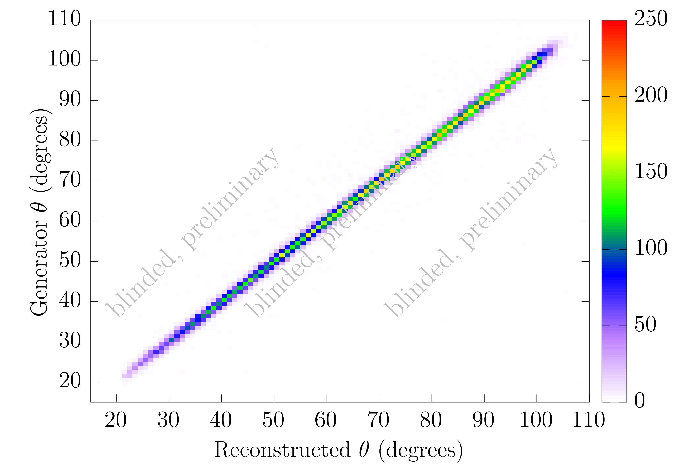

# Pion Proton Elastic Scattering Event Generator (PiPES)
- Purpose: low energy pion-proton elastic scattering at both charge polarties 
- Current capabilities:
    - Calculate upto f-wave contributions. More will be added 
    - Variable momentum selection within $\left[100, 350\right]$ MeV/$c$
    - Coulomb contributions are included 
    - Scattering may be rotated about an incident beam direction that is not uniformly down the $z$ direction
    - User may choose to output results in the CM or Lab frame 

On set of 20 iterations sampling 1000000 events, the generator ran at a speed of $902\pm209$ ms, corresponding to an average throughput of $1.11$ million events/s.

## Overview
PiPES is a pure C++, no external packages required header-only event generator. The phase shift values, and functional forms for the differential cross section, follow closely from the George Washington Groups SAID DB. In particular, we use the WI08 solutions phase shift parameters and theory curves in our comparisons.

## Output 
Outputs 2 angles: $\theta$ and $\phi$, in radians, in the frame of your choosing. $\theta$ gets rejection sampled based on $P(\cos(\theta))\sim\dfrac{d\sigma}{d\Omega}$.

## Results

### General $\pi^+ p$ Comparison to SAID 

### $160$ MeV/$c$ $\pi^+ p$ Comparison

Differences between the SAID values and PiPES theory curves may be for many reasons. These include that PiPES in these simulations only calculates $s$- and $p$- wave contributions, while SAID likely goes upto at least the J wave. As well, there may be small differences in the handling of the electromagnetic contributions.

## Hepful Papers/Websites
SAID Solutions: https://gwdac.phys.gwu.edu/
B. Tromborg, S. Waldenstrøm, and I. Ø verbø, Phys. Rev. D 15, 725 (1977)
R. Koch and E. Pietarinen, Nucl. Phys. A 336, 331 (1980)